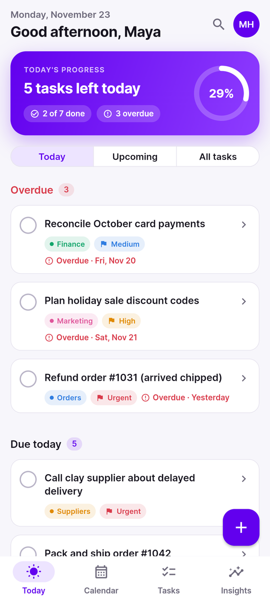
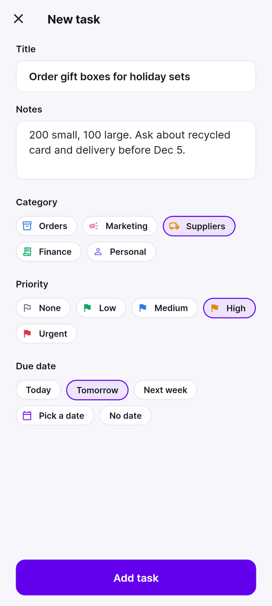
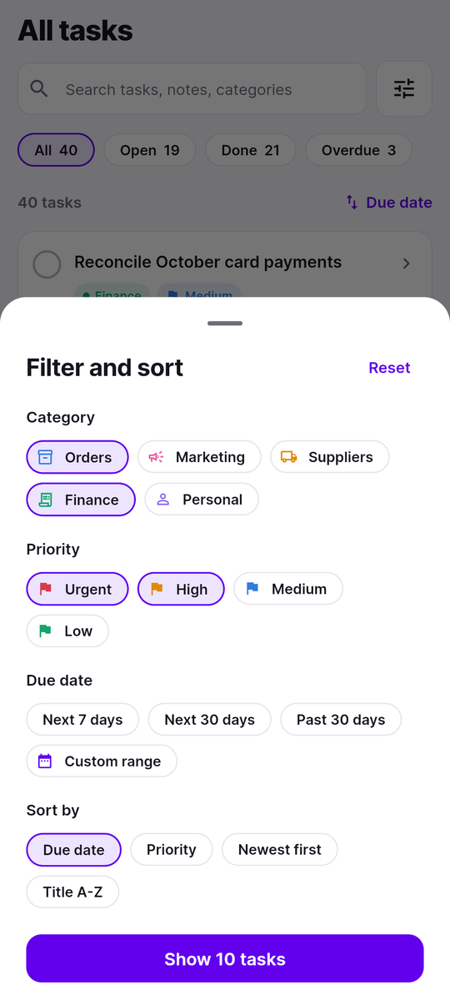
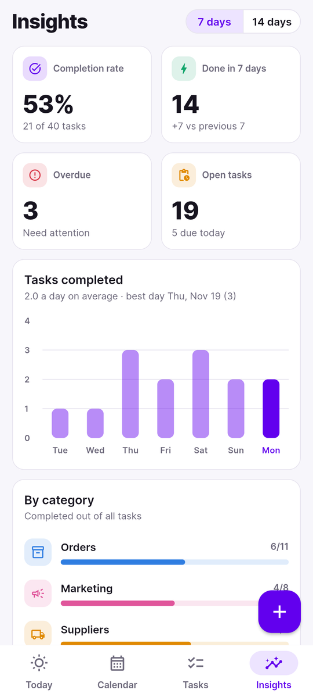
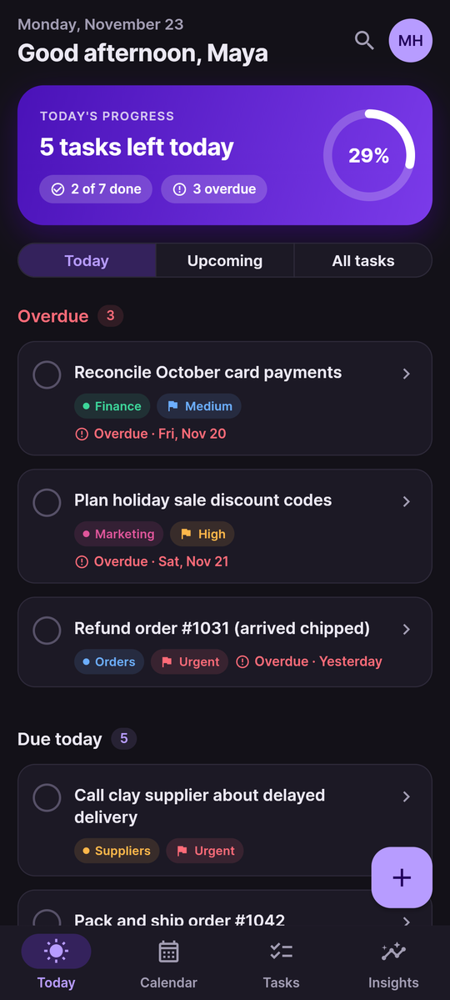

# Tasky

A task planner for a small business owner, built with Flutter and Firebase: today's work at a glance, a calendar, search and filters, and an insights dashboard.

| Today | Add task | Filters | Insights | Dark mode |
|---|---|---|---|---|
|  |  |  |  |  |

## Features

- Today view with progress, overdue and due-today sections
- Tasks with category, priority, due date and notes
- Month and week calendar with per-day markers
- Search, multi-select filters, date ranges and sort
- Insights: completion rate, tasks done per day, breakdown by category and priority
- Email sign-in with Firebase Auth; tasks stored per user in Cloud Firestore
- Light, dark and system themes

## Architecture

```
screens  ->  TaskStore (ChangeNotifier)  ->  TaskRepository / AuthRepository
                                              |- Cloud Firestore + Firebase Auth
                                              |- in-memory demo data
```

Filter, sort and insights logic are plain Dart classes (`lib/state/task_query.dart`, `lib/state/insights.dart`) with unit tests.

## Run it

```bash
flutter pub get

# Demo mode: no Firebase project needed
flutter run -d chrome --dart-define=DEMO=true

# With your own Firebase project
flutterfire configure
flutter run
```

```bash
flutter test
```

Tasky is a single-user planner. Sharing and team assignment are not implemented.
